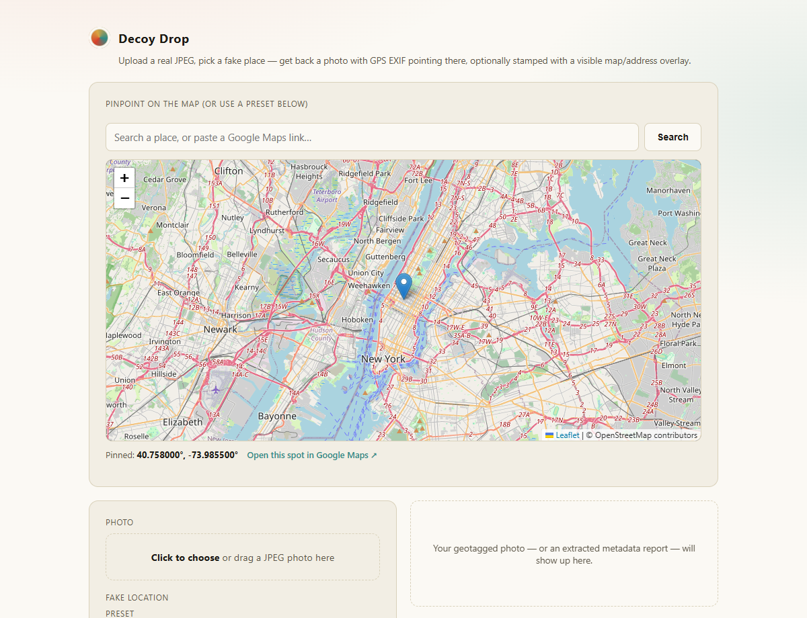
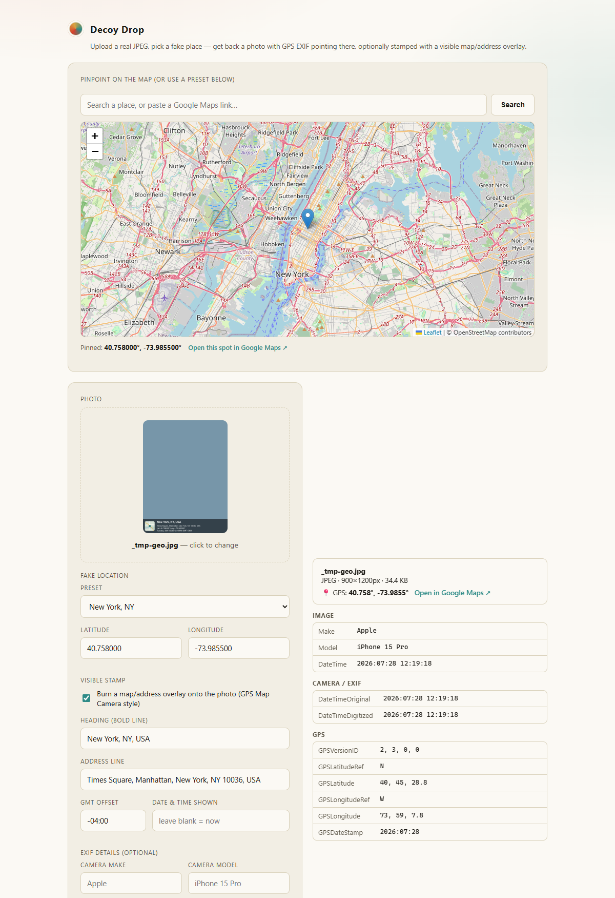

# Decoy Drop

A local web app with two tools for playing with photo location data:

1. **Fake geotag generator** — pick any place on a real, interactive map and get back your photo with GPS EXIF data (and optionally a visible "GPS Map Camera"-style overlay) pointing there.
2. **Metadata extractor** — upload any photo and see exactly what's hiding in its EXIF data: camera make/model, timestamps, and GPS coordinates (with a one-click link to view them on Google Maps).

Built for pranking friends ("look, I'm in Tokyo!") — not for faking proof of whereabouts for anything that actually matters.



## Features

### Fake geotag generator
- **Real interactive map** (Leaflet + OpenStreetMap tiles) — drag to pan, scroll to zoom, exactly like a normal map, not a static image
- **Search by place name** ("Eiffel Tower", "Shibuya Crossing, Tokyo") via OpenStreetMap's Nominatim geocoder
- **Paste a Google Maps link** (including shortened `goo.gl` / `maps.app.goo.gl` links) to jump straight to that exact spot
- **"Open in Google Maps"** link for whatever you've pinned, so you can cross-check it or grab a Street View screenshot too
- **Click, drag, or type coordinates** — the pin, the lat/lng fields, and the map all stay in sync, and dropping a pin reverse-geocodes a real street address automatically
- **Preset cities** (New York, London, Paris, Tokyo, Dubai, Sydney, Reykjavik, Rio, Bali) as quick shortcuts
- **Visible on-photo stamp** in the style of GPS Map Camera / similar apps — a map thumbnail, place name, address, coordinates, and timestamp burned directly into the image. The layout adapts its font size and wrapping to the photo's actual proportions (portrait phone screenshots, square, wide landscape — all fit without overflowing)
- **Real GPS EXIF metadata** written into the JPEG itself, not just a visual overlay, so it shows up if the photo's "location" is checked in Photos apps, Google Photos, etc.
- Optional camera make/model and custom timestamp for extra realism

### Metadata extractor
- Drop in any JPEG and hit **"Extract metadata only"** — no location picking required
- Shows file info (format, dimensions, size), a GPS summary (with a Google Maps link if coordinates are present), and every readable EXIF tag grouped by section (Image, Camera/Exif, GPS, Thumbnail)
- Useful for double-checking that a geotag actually took effect, or for seeing what a real camera photo already reveals about itself



## Getting started

```bash
npm install
npm start
```

Then open **http://localhost:3131**.

## How it works

- **Frontend**: plain HTML/CSS/JS, [Leaflet](https://leafletjs.com/) for the map — no build step.
- **Backend**: [Express](https://expressjs.com/) serves the app and a few small API routes:
  - `POST /api/geotag` — takes a JPEG + coordinates, optionally composites the visible stamp (via [sharp](https://sharp.pixelplumbing.com/)), writes GPS/camera EXIF tags (via [piexifjs](https://github.com/hMatoba/piexifjs)), and returns the result.
  - `POST /api/inspect` — reads a photo's EXIF/GPS metadata without modifying it.
  - `GET /api/geocode`, `GET /api/reverse` — proxy place search and reverse geocoding to OpenStreetMap's Nominatim (keeps a proper User-Agent per their usage policy).
  - `GET /api/resolve-link` — follows shortened Google Maps links to their final URL, restricted to a small allowlist of Google/goo.gl hostnames.
- **Map tiles and place search are fetched live from OpenStreetMap** — that part needs an internet connection. All the actual photo/EXIF processing happens locally on your machine; no photo you upload is ever sent anywhere.

## A note on responsible use

This tool edits real photo pixels and metadata convincingly. Use it for jokes among friends who are in on it. Don't use it to fake proof of whereabouts for anything that actually matters — alibis, safety check-ins, insurance claims, or anything where someone might reasonably rely on the location being real.

## License

MIT
